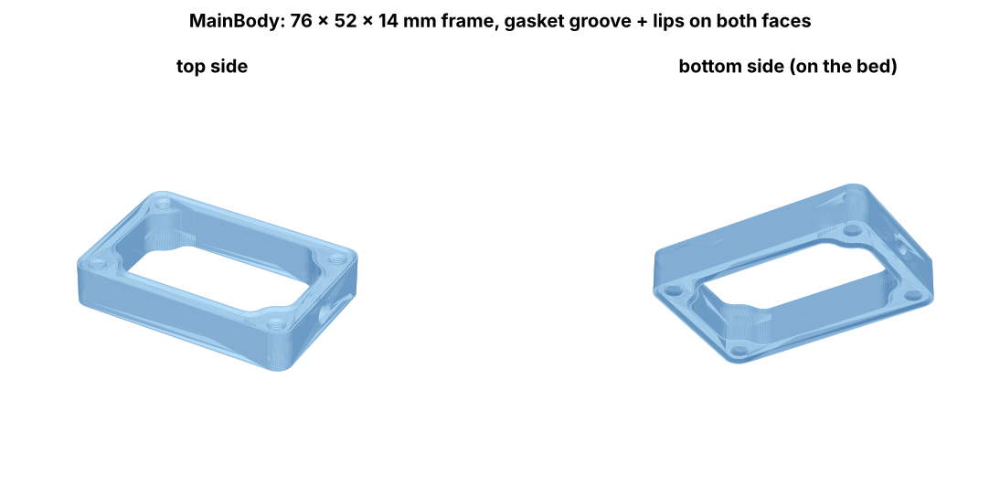
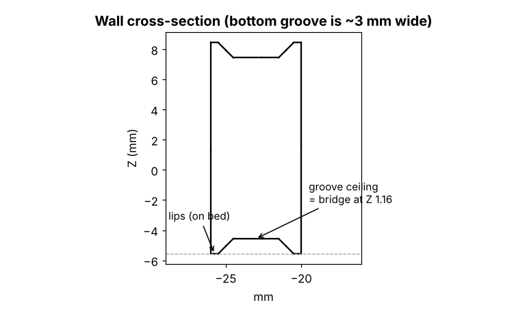
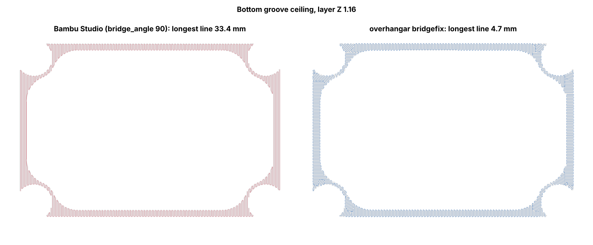
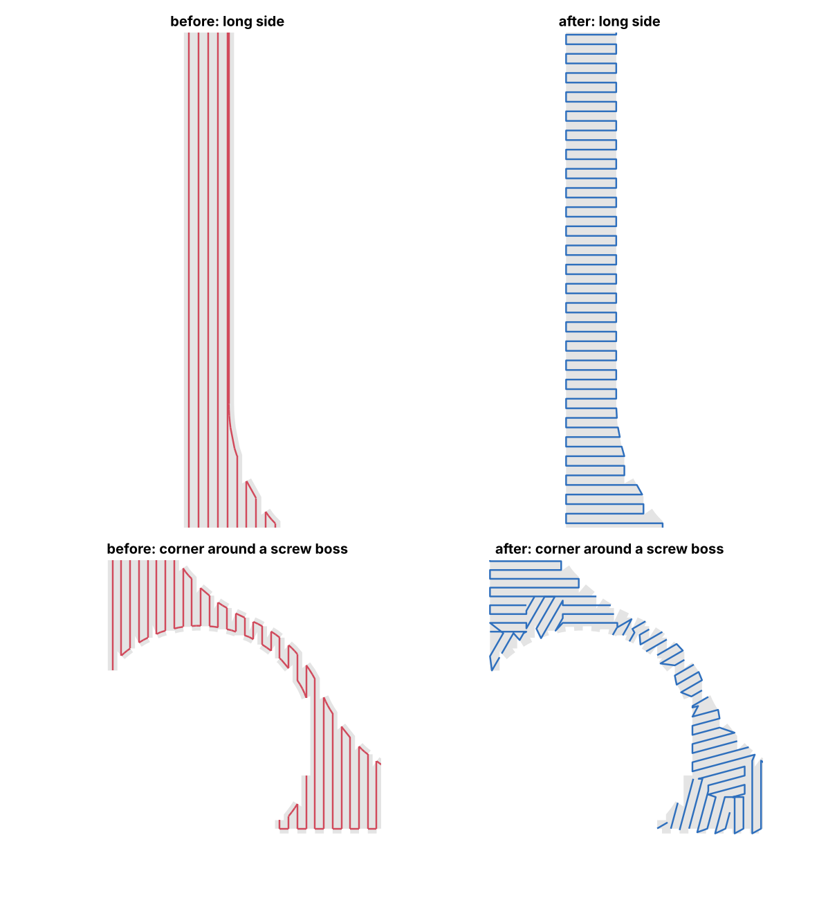
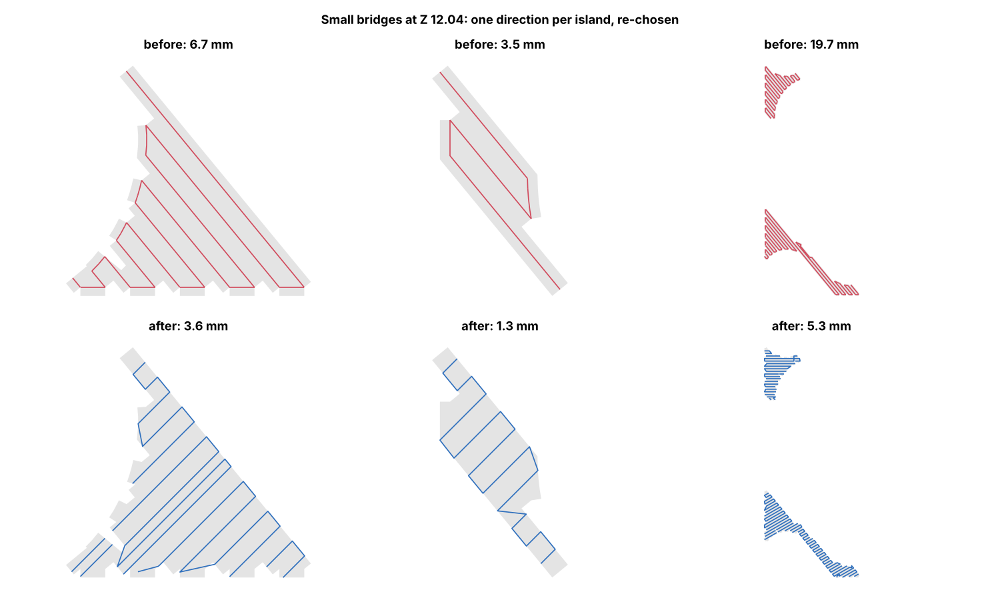

# overhangar

G-code post-processing and pre-slicing planning for FDM printing (Bambu Studio / OrcaSlicer).

The longer-term plan is a planning layer in front of the slicer (mesh analysis, critical-face intent, per-region strategy: membranes, conical layers, arc overhangs). The first tool is `bridgefix`.

> **Heads-up:** this is an experimental hobby project, and much of the code was
> written with an AI assistant (Claude). It writes G-code that your printer
> will execute, so check the slicer preview before printing and stay near the
> printer on the first run. You use it at your own risk. See
> [Disclaimer](#disclaimer).

## bridgefix: shortest-span bridge post-processor (Bambu Studio / OrcaSlicer)

Bambu Studio uses one bridge direction per bridge island, or one fixed
`bridge_angle`. On ring- or L-shaped bridges, such as gasket-groove ceilings,
slots and frames, some lines then run **along** the gap instead of across it.
`bridgefix` rewrites every `; FEATURE: Bridge` block so that each part of the
bridge is filled across its shortest anchor-to-anchor span.

How it works:
1. Rebuilds the bridged area from the block's extrusion moves (arcs are converted to line segments).
2. For each cell of a 0.8 mm grid, finds the direction with the shortest chord.
   Where the slicer's own direction is nearly as short, it is kept.
3. If one direction is good enough for a whole island, that island stays one
   zone. Otherwise the island is split into zones, and tiny zones are merged
   into a neighbour.
4. Refills each zone with straight lines. Line spacing, flow (E/mm), speed, fan
   and other non-move commands come from the original block.
5. Fills leftover gaps, then restores position, Z and retraction state, so the
   rest of the file stays byte-identical.

A block is only rewritten if the longest span drops by at least 30 %
(`--force` overrides this).

## Example: Heltec V4 outdoor case

Files: [`examples/heltec-v4-case/`](examples/heltec-v4-case/)



`MainBody` is a 76 × 52 × 14 mm PLA frame. Both faces have a gasket groove
between two 0.5 mm lips. It prints flat, so the **bottom groove ceiling is a
~3 mm wide bridge 1 mm above the bed**, all the way around the ring:



Bambu Studio (2.0.2, `bridge_angle = 90`) bridges the whole ring in one
direction. On the two long sides the lines therefore run **along** the groove,
33 mm unsupported. With auto angle (0) it still picks one angle for the whole
ring, so two sides are always wrong.



Close-up: on the long side the lines now cross the 2 mm groove; around the
screw bosses the direction follows the curve.



The small bridges at Z 12.04 keep one direction per island (no fragmenting),
but the direction is re-chosen for the shortest span:



| Layer | Bridge area | Longest line, Bambu | Longest line, bridgefix |
|---|---|---|---|
| Z 1.16 | groove ring | 33.4 mm | 4.7 mm |
| Z 12.04 | 7 small islands | 3.5 – 19.7 mm | 1.3 – 5.3 mm (2 left unchanged) |

Reproduce:
```
python bridgefix/bridgefix.py examples/heltec-v4-case/HeltecV4CaseOutdoorV2.gcode.3mf \
    -o examples/heltec-v4-case/HeltecV4CaseOutdoorV2.bridgefix.gcode.3mf
python tools/make_figures.py      # regenerates docs/images (needs trimesh, lxml)
```

Status: the rewritten file opens in Bambu Studio and the preview shows the
new paths. **A test print is still pending.**

### Install
```
pip install -r requirements.txt
```

### Use
```
python bridgefix/bridgefix.py model.gcode.3mf -o model.bridgefix.gcode.3mf --preview preview.png
python bridgefix/bridgefix.py model.gcode -o model.fixed.gcode
python bridgefix/bridgefix.py model.gcode            # rewrites the file in place
```
For a `.gcode.3mf`, the tool rewrites `Metadata/plate_N.gcode` and updates its
`.md5`. Send the result to the printer from Bambu Studio (open it, then Print),
or copy it to the SD card.

As a slicer post-processing script (Others → Post-processing scripts), use:
`"C:\path\to\python.exe" "C:\path\to\bridgefix.py";`. The slicer passes the
G-code path, and the script edits it in place.

Options: `--grid` (zone cell size in mm), `--angle-step` (direction resolution
in degrees), `--anchor` (extra extension of line ends into anchors, in mm),
`--internal` (also rewrite `Internal Bridge` blocks), `--force`.

### Limits and assumptions
- Assumes relative E (`M83`), the Bambu/Orca default, and that the slicer
  unretracts before each feature.
- Treats the edge of the bridged area as anchored. This holds for slicer bridge
  regions.
- Rewritten bridges are emitted as G1 moves (no arcs).
- Line ends run onto the anchor, so a bridge layer uses about 5–10 % more filament.
- The print-time estimate (M73) is not recalculated.

## License

Copyright (C) 2026 fsaritome.

- **Code** (`bridgefix/`, `tools/`, `tests/`): [GNU AGPL-3.0](LICENSE). It
  includes an additional term under section 7(b): keep the author attribution
  *"Based on overhangar by fsaritome"* with a link to this repo (see [NOTICE](NOTICE)).
  Commercial use is allowed. If you distribute a modified version, or run one
  as a network service, you must publish its source under the AGPL.
- **Example model and G-code** (`examples/heltec-v4-case/`):
  [CC BY 4.0](examples/heltec-v4-case/LICENSE). Free to use, including
  commercially, as long as you give credit.

Want to use this in a closed-source product? Open an issue to ask about a
separate commercial license.

## Disclaimer

Friendly, but important:

- **AI-assisted.** Much of this project, including the code, docs and figures,
  was produced with an AI assistant (Claude) and then reviewed and tested by
  me. Tests and preview checks pass, but AI-written code can contain mistakes
  that nobody has noticed yet.
- **Experimental.** It rewrites G-code that moves a hot nozzle around your
  printer. A bug could mean a failed print, wasted filament, a nozzle crash
  or blob, or worse. Always open the output in your slicer's preview first,
  and watch the first layers of the print.
- **Your risk.** You use this software and the example files entirely at your
  own risk. It comes **without any warranty**, and the author is **not
  liable** for any damage to printers, parts, property or anything else, or
  for any other loss, however it is caused. This adds to the warranty
  disclaimer and limitation of liability in sections 15–16 of the
  [AGPL-3.0](LICENSE).

Found a problem? Open an issue, ideally with the G-code and a photo. Every
report makes it safer for the next person.
